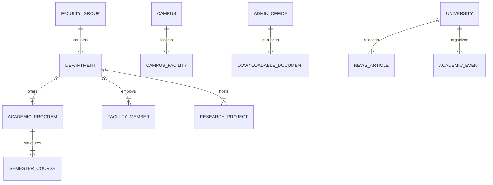

# University of Swat — Reusable Content Models & Entity Schemas
**Document Status**: Official Architecture Specification (Pre-Implementation)  
**Standard**: TypeScript 5 Strict Schemas & Schema.org Structured Data  
**Scope**: All Core Institutional Entities

---

## 1. Entity Relationship Overview



---

## 2. Core Content Entity Definitions

### 1. Academic Program (`ProgramDetail`)
Represents an official degree credential accredited by HEC and professional regulatory bodies (e.g., NCEAC, PCB, PBC).

```typescript
export interface AcademicProgram {
  slug: string;                           // Required: URL identifier (e.g. "bs-computer-science")
  name: string;                           // Required: Full degree title
  degreeLevel: "Undergraduate (BS)" |     // Required: Academic tier
               "Graduate (MS/MPhil)" | 
               "Doctoral (PhD)";
  duration: string;                       // Required: E.g. "4 Years (8 Semesters)"
  creditHours: number;                    // Required: Total credits (e.g. 132)
  facultyGroup: string;                   // Required: Name of parent faculty
  departmentId: string;                   // Required: Slug of offering department
  departmentName: string;                 // Required: Name of offering department
  description: string;                    // Required: Authoritative academic narrative (100-250 words)
  eligibility: string;                    // Required: High school / F.Sc percentage and prerequisite subjects
  learningOutcomes: string[];             // Required: 4-6 specific competency bullet points
  careerProspects: string[];              // Required: 4-6 industry and academic employment pathways
  semesterOutline: {                      // Required: Complete 8-semester course list
    semester: string;                     // E.g. "Semester 1"
    courses: string[];                    // Course titles
  }[];
  feePerSemester: string;                 // Required: Exact tuition amount in PKR (Open Merit vs. Self-Finance)
  accreditation?: string;                 // Optional: E.g. "NCEAC Benchmark W-Category"
}
```

---

### 2. Academic Department (`FacultyDepartment`)
Represents a teaching department, school, or specialized research centre.

```typescript
export interface FacultyDepartment {
  id: string;                             // Required: Kebab-case slug (e.g. "physics")
  name: string;                           // Required: Official name (e.g. "Department of Physics")
  facultyGroup: string;                   // Required: Parent faculty category
  aims: string;                           // Required: Strategic educational objective (1-2 sentences)
  description: string;                    // Required: Department overview, facilities, labs
  programsOffered: string[];              // Required: List of degree programs offered
  headOfDepartment: string;               // Required: Name of current Chairman / HoD
  facultyMembers?: FacultyMember[];       // Optional: List of teaching professors and lecturers
  contactEmail: string;                   // Required: Departmental email
  phoneExtension?: string;                // Optional: PBX internal extension
  location?: string;                      // Optional: Building & block (e.g. "Academic Block A, Charbagh")
}
```

---

### 3. Faculty Member (`FacultyMember`)
Represents an academic professor, researcher, or statutory lecturer.

```typescript
export interface FacultyMember {
  name: string;                           // Required: Full name with title (e.g. "Dr. Niamat Ullah")
  designation: string;                    // Required: Rank (e.g. "Professor (BPS-21) / HoD")
  qualification: string;                  // Required: Terminal degree (e.g. "Ph.D Computer Science")
  specialization?: string;                // Optional: Research subfield (e.g. "Distributed Systems")
  image?: string;                         // Optional: Path to authentic portrait photograph
  email?: string;                         // Optional: Official university email
  researchgateUrl?: string;               // Optional: Scholarly profile link
}
```

---

### 4. News Article / Press Release (`NewsArticle`)
Represents an authenticated press release, event dispatch, or research breakthrough.

```typescript
export interface NewsArticle {
  slug: string;                           // Required: E.g. "solarization-project-launch"
  title: string;                          // Required: Formal editorial headline
  date: string;                           // Required: ISO date (e.g. "2026-10-24")
  formattedDate: string;                  // Required: Display date (e.g. "October 24, 2026")
  category: "Leadership" | "Sustainability" | // Required: Topic classification
            "Research" | "Academics" | "Partnership";
  summary: string;                        // Required: 2-sentence synopsis
  content: string[];                      // Required: Multi-paragraph body text
  image: string;                          // Required: Authentic photograph path
  imageCaption: string;                   // Required: Contextual caption
  officialStatement?: {                  // Optional: Direct quote from Vice Chancellor or Dean
    speaker: string;
    quote: string;
  };
}
```

---

### 5. Academic & Cultural Event (`UniversityEvent`)
Represents a scheduled seminar, convocation, sports tournament, or examination milestone.

```typescript
export interface UniversityEvent {
  slug: string;                           // Required: Unique URL slug
  title: string;                          // Required: Event name
  category: "Academic Conference" |       // Required: Event type
            "Sports Gala" | "Workshop" | 
            "Convocation" | "Symposium";
  startDate: string;                      // Required: ISO date
  endDate?: string;                       // Optional: Concluding date
  time: string;                           // Required: E.g. "09:30 AM - 04:00 PM PST"
  venue: string;                          // Required: Hall / ground / campus
  organizer: string;                      // Required: Department or Directorate
  description: string;                    // Required: Detailed event briefing
  registrationDeadline?: string;          // Optional: Cut-off date for attendees
  callForPapersUrl?: string;              // Optional: Scholarly submission link
}
```

---

### 6. Official Downloadable Document (`DownloadableDocument`)
Represents a regulatory form, examination application, or institutional statutory document.

```typescript
export interface DownloadableDocument {
  id: string;                             // Required: Unique identifier
  title: string;                          // Required: Document name
  category: "Admissions" | "Examinations" | // Required: Document grouping
            "Scholarships" | "Faculty Forms" | 
            "Statutes & Rules";
  fileSize: string;                       // Required: E.g. "1.2 MB"
  fileFormat: "PDF" | "DOCX";             // Required: File format
  downloadUrl: string;                    // Required: Canonical public path
  releaseDate: string;                    // Required: Date of notification
  targetAudience: "Students" | "Faculty" | "Affiliated Colleges";
}
```

---

### 7. Merit List Gazette (`MeritListEntry`)
Represents a departmental provisional or final admissions quota gazette.

```typescript
export interface MeritListEntry {
  id: string;                             // Required: Unique gazette code
  department: string;                     // Required: Department name
  program: string;                        // Required: Degree program
  quota: "Open Merit" | "District Swat" | // Required: Quota category
         "FATA / Merged Areas" | "Balochistan" | "Disabled";
  listType: "Provisional Merit List" |    // Required: Stage of admission
            "1st Final Merit List" | 
            "2nd Final Merit List";
  date: string;                           // Required: Date of release
  closingPercentage: string;              // Required: E.g. "78.45%"
  pdfUrl: string;                         // Required: Downloadable gazette PDF
}
```

---

### 8. Campus Specification (`CampusProfile`)
Represents physical campus grounds (Charbagh Main Campus, Women Sub-Campus).

```typescript
export interface CampusProfile {
  slug: string;                           // Required: E.g. "main-campus"
  name: string;                           // Required: E.g. "Charbagh Main Campus"
  acreage: string;                        // Required: E.g. "130 Acres"
  location: string;                       // Required: E.g. "Charbagh, Swat Expressway Link"
  solarCapacity: string;                  // Required: E.g. "1.2 MW Self-Sustaining Grid"
  studentCapacity: string;                // Required: E.g. "5,000+ Students"
  hostelCapacity: string;                 // Required: Residential accommodation
  keyFacilities: string[];                // Required: List of landmark facilities
  departmentsHoused: string[];            // Required: List of resident departments
  heroImage: string;                      // Required: Landmark photograph
  galleryImages: string[];                // Required: 4-6 facility photographs
}
```
