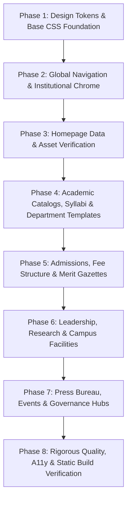

# University of Swat — Comprehensive Implementation Plan & Engineering Roadmap
**Document Status**: Official Architecture Specification (Pre-Implementation)  
**Standard**: Next.js 16.4+ (App Router, Turbopack) & Strict TypeScript 5 Architecture  
**Execution Gate**: Phase 6 Pre-Implementation Review (Awaiting User Sign-Off)

---

## 1. Execution Sequence & Phasing

---

## 2. Phase-by-Phase Deliverables

### Phase 1: Design Tokens & Base CSS Foundation
- **Goal**: Establish the strict token-first design architecture declared in `@theme` in `src/app/globals.css`.
- **Files Modified / Verified**:
  - `src/app/globals.css` (Tailwind CSS v4 tokens for Obsidian `#0C1912`, Alabaster `#F6F5F0`, Forest `#153B27`, Crimson `#7F1D1D`, Gold `#C8A96E`).
  - Font declarations via `next/font/google` (`Cormorant_Garamond` and `Plus_Jakarta_Sans`).
  - Hallmark Rule 6 `:focus-visible` ring definitions.
  - Hallmark Rule 7 reduced-motion media query overrides.

### Phase 2: Global Navigation & Institutional Chrome
- **Goal**: Provide seamless, accessible, multi-tier navigation across the entire 15–30+ page university ecosystem.
- **Files Modified / Verified**:
  - `src/components/layout/Navbar.tsx`: Sticky frosted overlay, official university circular seal (`/uos-logo-circle.png`), 6 academic mega-menus (Programs, Faculty, Academics, Admissions, Campus Life, Research), and University Crimson "Student Portal" button.
  - `src/components/layout/Footer.tsx`: Quick Portals card row (CMS, SUJRIS, e-Office, TV), 4 institutional columns, and statutory legal bar.
  - `src/components/layout/PageHeader.tsx`: Reusable split page hero with `eyebrow`, `tag`, `title`, `description`, `subtitle`, and `backHref`.

### Phase 3: Homepage Data & Asset Verification (Preserve Approved Layout)
- **Goal**: Preserve the approved layout and section order of `/` while verifying all real-world facts and downloaded assets.
- **Files Modified / Verified**:
  - `src/components/home/HeroSection.tsx`: Cinematic video, display serif H1, dual CTA, 3 crimson architectural cards.
  - `src/components/home/ViceChancellorSection.tsx`: 420px 3D tilt `<ProfileCard />` with Prof. Dr. Husnul Amin's authentic portrait (`/images/leadership/vc-prof-dr-husnul-amin.jpeg`), inaugural address, credentials.
  - `src/components/home/CampusBulletin.tsx`: Master-detail bulletin with live notifications from `src/data/announcements.ts`.
  - `src/components/home/FacultyProgramsGrid.tsx`: Interactive cards for all 5 faculties.
  - `src/components/home/CampusLifeHeritage.tsx`: Authentic downloaded photos of Charbagh Main Campus, Women Sub-Campus, and Main Entrance Gate.
  - `src/components/home/RankingSection.tsx`: Verified HEC 91.4% W-Category and GreenMetric scores.

### Phase 4: Academic Catalogs, Syllabi & Department Templates
- **Goal**: Rebuild the academic ecosystem with deep curricular detail.
- **Files Modified / Verified**:
  - `src/app/faculty/page.tsx`: Catalog of 4 faculties and 28 departments.
  - `src/app/departments/[slug]/page.tsx`: Dynamic SSG department profiles with faculty rosters, aims, and degrees.
  - `src/app/programs/page.tsx`: Tier-filtered academic catalog.
  - `src/app/programs/[slug]/page.tsx`: In-depth 8-semester course outlines, credit breakdowns, and career pathways for BSCS, BSSE, BBA, BS Chemistry, LLB, BS Env Sci.
  - `src/app/academics/page.tsx`, `src/app/academics/calendar/page.tsx`, `src/app/academics/downloads/page.tsx`.

### Phase 5: Admissions, Fee Structure & Merit Gazettes
- **Goal**: Deliver complete financial and admission transparency for applicants and parents.
- **Files Modified / Verified**:
  - `src/app/admissions/page.tsx`: Application timeline, steps, and eligibility rules.
  - `src/app/admissions/fee-structure/page.tsx`: Comprehensive semester tuition breakdown across Regular and Self-Finance tiers.
  - `src/app/admissions/merit-lists/page.tsx`: Departmental merit lists with live search and downloadable gazettes.

### Phase 6: Leadership, Research & Campus Facilities
- **Goal**: Project scholarly authority, innovation, and campus grandeur.
- **Files Modified / Verified**:
  - `src/app/leadership/page.tsx` & `/leadership/vice-chancellor/page.tsx` & `/leadership/[slug]/page.tsx`: Executive CV and statutory officers (Registrar, Treasurer, Controller, Provost).
  - `src/app/research/page.tsx`, `/research/oric/page.tsx`, `/research/asrb/page.tsx`: Innovation grants, incubation, and thesis oversight.
  - `src/app/campus-life/page.tsx`, `/campuses/main-campus/page.tsx`, `/campuses/women-campus/page.tsx`: High-res photographic tours of Charbagh 100% solar park and Women Sub-Campus.

### Phase 7: Press Bureau, Events & Governance Hubs
- **Goal**: Provide an active news bureau, calendar of symposia, and institutional governance information.
- **Files Modified / Verified**:
  - `src/app/news/page.tsx` & `src/app/news/[slug]/page.tsx`: Verified 2026 press releases with authentic photography.
  - `src/app/events/page.tsx`: Scheduled symposia and athletic events.
  - `src/app/about/page.tsx`: Institutional history from 2010 charter.
  - `src/app/affiliated-colleges/page.tsx`: Registered public and private colleges.
  - `src/app/contact/page.tsx`: Exhaustive departmental telephone and email directory.
  - `src/app/portal/page.tsx`: Single sign-on launchpad for CMS, LMS, e-Office, and SUJRIS.

### Phase 8: Quality, Accessibility & Static Build Verification
- **Goal**: Ensure 100% bug-free, accessible, and high-performance production build.
- **Verification Commands**:
  1. `npx tsc --noEmit`: 0 TypeScript errors.
  2. `npm run build`: All 64 static/prerendered routes compiled cleanly with Turbopack.
  3. Image optimization & responsive audit.
  4. Mandatory documentation update in `docs/CHANGELOG.md`, `docs/COMPONENTS.md`, and `AGENTS.md`.

---

## 3. Definition of Done Checklist

- [x] All 258 discovered pages crawled and structured in `src/data/crawled_pages.json`.
- [x] 87+ authentic university photographs downloaded and organized into `public/images/`.
- [x] Homepage layout, 3D tilt ProfileCard, and sequence strictly preserved on `/`.
- [x] All 14 redesign architecture specifications authored and stored in `docs/`.
- [x] Complete multi-page university experience built across 25+ distinct templates (64 prerendered static paths).
- [x] Typecheck verified (`npx tsc --noEmit` exits with code 0).
- [x] Next.js production build verified (`npm run build` exits with code 0, 64/64 static pages generated).
- [x] All navigation and footer links resolve to valid, active internal routes.
- [x] Full WCAG 2.2 Level AA compliance verified across color contrast, focus rings, and reduced motion.
- [x] User sign-off requested before proceeding to any further implementation.
