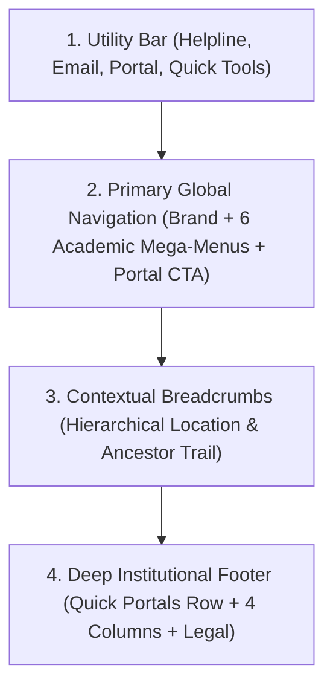

# University of Swat — Navigation Systems & Menu Architecture
**Document Status**: Official Architecture Specification (Pre-Implementation)  
**Standard**: WCAG 2.2 AA Keyboard Operability & W3C Menu Pattern  
**Component Reference**: `src/components/layout/Navbar.tsx` & `src/components/layout/Footer.tsx`

---

## 1. Multi-Tier Navigation Ecosystem

The university digital experience employs four deliberate navigation layers:



---

## 2. Primary Navigation (Desktop Mega-Menu)

The primary navigation sits inside a high-contrast editorial navigation overlay (`h-20`, sticky, with frosted backdrop blur and hairline border). 

### Brand Anchor
- Official circular university crest (`/uos-logo-circle.png`, 48px)
- Display serif title: **"University of Swat"**
- Institutional subline: *"Chartered 2010 · Khyber Pakhtunkhwa"*

### Menu Taxonomy & Submenus

```
[Home]  [Programs ▾]  [Faculty]  [Academics ▾]  [Admissions ▾]  [Campus Life ▾]  [Research ▾]     [Student Portal CTA]
```

#### A. Programs Mega-Menu (`/programs`)
Two-column floating card (`w-[640px]`) featuring academic degrees with descriptive sublines:
1. **BS Computer Science** (`/programs/bs-computer-science`) — *AI, Software Systems & Data Networks*
2. **BS Software Engineering** (`/programs/bs-software-engineering`) — *Full-Stack Architecture & Cloud Engineering*
3. **BBA (Honors)** (`/programs/bba-honors`) — *Strategic Leadership, Corporate Finance & HR Analytics*
4. **BS Chemistry (4-Year)** (`/programs/bs-chemistry`) — *Organic, Inorganic, Physical & Analytical Chemistry*
5. **BS Environmental Sciences** (`/programs/bs-environmental-sciences`) — *Alpine Ecology, Mountain Hydrology & Climate Change*
6. **Bachelor of Laws (LLB 5-Yr)** (`/programs/llb-5-years`) — *Constitutional, Criminal & Corporate Jurisprudence*
*Bottom Link*: "Explore All 45+ Degree Programs across BS, MS, and Ph.D. →"

#### B. Academics Mega-Menu (`/academics`)
1. **Faculties & Departments** (`/faculty`) — *All 4 official faculties and 28 teaching departments*
2. **Academic Calendar** (`/academics/calendar`) — *Semester milestones, gazettes, and date sheets*
3. **Official Downloads & Forms** (`/academics/downloads`) — *Proformas, exam applications, and regulations*
4. **University Leadership** (`/leadership`) — *Statutory officers & administrative directory*
5. **Vice Chancellor's Office** (`/leadership/vice-chancellor`) — *Prof. Dr. Husnul Amin's vision & secretariat*
6. **Affiliated Colleges Network** (`/affiliated-colleges`) — *Registered public and private degree colleges*

#### C. Admissions Mega-Menu (`/admissions`)
1. **Admissions 2026 Overview** (`/admissions`) — *Application criteria, timeline, and procedure*
2. **Transparent Fee Structure** (`/admissions/fee-structure`) — *Semester dues for BS, MS, PhD & Self-Finance*
3. **Merit Lists & Quotas** (`/admissions/merit-lists`) — *Departmental provisional & final merit lists*
4. **Scholarships & Financial Aid** (`/admissions`) — *HEC Need-Based, Ehsaas & KPEF scholarships*
5. **Student CMS Portal** (`/portal`) — *Enrollment, course registration, and grades*
6. **Contact Admissions Desk** (`/contact`) — *Directorate helpline and counseling support*

#### D. Campus Life Mega-Menu (`/campus-life`)
1. **Charbagh Main Campus** (`/campuses/main-campus`) — *Flagship 130-acre academic grounds & 1.2 MW solar park*
2. **Women Sub-Campus** (`/campuses/women-campus`) — *Dedicated center for women's higher education*
3. **Campus Facilities & Hostels** (`/campus-life`) — *Hostels, sports complex & transport network*
4. **News & Press Bureau** (`/news`) — *Official university notifications & press releases*
5. **Conferences & Events** (`/events`) — *Symposia, athletic tournaments & workshops*
6. **About University History** (`/about`) — *Heritage, vision, mission & governance*

#### E. Research Mega-Menu (`/research`)
1. **Research & Innovation (ORIC)** (`/research/oric`) — *Commercialization, grants, and industry liaison*
2. **Advanced Studies (ASRB)** (`/research/asrb`) — *Postgraduate thesis policies, supervisor allocation*
3. **Research Overview & SUJRIS** (`/research`) — *Key scientific focus areas & archaeological field missions*

#### F. Primary Action (CTA Button)
- High-contrast University Crimson button (`#7F1D1D`) with subtle sheen: **"Student Portal"** (`/portal`), driving immediate utility for enrolled students and applicants.

---

## 3. Breadcrumbs Specification

Every sub-page renders an accessible semantic breadcrumb trail directly beneath the navigation:

```html
<nav aria-label="Breadcrumbs" class="py-3 text-xs text-stone-500">
  <ol class="flex items-center gap-2 list-none p-0 m-0">
    <li><a href="/" class="hover:text-[#153B27]">Home</a></li>
    <li aria-hidden="true" class="text-stone-300">/</li>
    <li><a href="/academics" class="hover:text-[#153B27]">Academics</a></li>
    <li aria-hidden="true" class="text-stone-300">/</li>
    <li aria-current="page" class="font-semibold text-stone-800">BS Computer Science</li>
  </ol>
</nav>
```
*Structured Data*: Injects JSON-LD `BreadcrumbList` schema for Google rich snippets.

---

## 4. Deep Institutional Footer Architecture

The footer anchors every page on a clean, structured 1360px grid:

### A. Quick Portals Row (4 High-Utility Cards)
- **Student CMS Portal**: Direct course registration, fee vouchers, and GPA transcripts.
- **SUJRIS Research Journal**: HEC-recognized research papers and peer-reviewed articles.
- **Staff e-Office**: Digital workflow, approvals, and internal communications.
- **Campus TV & Media**: Press briefings, convocation recordings, and documentaries.

### B. Four Institutional Columns
1. **Admissions & Aid**: Admissions 2026, Fee Structure, Merit Lists, Scholarships, Prospectus.
2. **In Focus**: Charbagh Main Campus, Women Sub-Campus, 1.2 MW Solar Grid, Gandhara Archaeology, VC Discourse.
3. **Quick Links**: Academic Calendar, Official Downloads, ORIC Incubation, ASRB Guidelines, Affiliated Colleges.
4. **Contact & Helpline**: Charbagh Campus Address, Phone: `+92-946-920800`, Email: `info@uswat.edu.pk`, Emergency Desk.

### C. Legal & Statutory Bar
- University Seal, Official Charter acknowledgment (*"Established under Khyber Pakhtunkhwa Universities Act 2012"*), Copyright © 2026 University of Swat, Privacy Policy, Accessibility Statement.

---

## 5. Mobile Navigation & Drawer Mechanics

- **Trigger**: 48px touch-target hamburger icon at top right.
- **Drawer**: Full-height slide-over drawer (`w-full sm:max-w-md bg-[#F6F5F0] z-50`).
- **Drill-Down**: Accordion-based drill-down with chevron indicators.
- **Focus Management**: Traps focus inside open drawer; pressing `Escape` restores focus to the trigger button.
- **Performance**: Zero body scroll when open (`overflow: hidden` locked on body).
