# University Brief & Institutional Strategy
**Institution**: University of Swat (*Sowat University*)  
**Location**: Charbagh, Swat Valley, Khyber Pakhtunkhwa, Pakistan  
**Document Status**: Official Architecture Specification (Pre-Implementation)  
**Version**: 3.0.0 (Editorial & Institutional Masterplan)

---

## 1. Executive Summary & Purpose

The University of Swat (established under the Khyber Pakhtunkhwa Universities Act 2012, chartered 2010) is a premier public research university located in the historically rich and ecologically vital Swat Valley. 

The university was founded in the wake of regional restoration to serve as a beacon of enlightenment, peace, and intellectual advancement in Northern Pakistan. Today, it stands as an HEC Recognized "W-Category" institution (ranked 91.4% by HEC QAC, GreenMetric Top 15 in Pakistan, and ranked in Times Higher Education Impact Rankings 301–400).

### Core Mission & Institutional Positioning
> **"Preserving Himalayan & Gandharan Heritage while Driving Frontier Computational Sciences, Sustainable Mountain Ecology, and Inclusive Regional Higher Education."**

Unlike generic modern universities, the University of Swat possesses an extraordinary physical and cultural setting:
1. **Gandhara Heritage & Ancient Archaeology**: Situated in the cradle of Buddhist Gandharan art, hosting active joint missions with the Italian Archaeological Mission (ISMEO / Prof. Dr. Luca Maria Olivieri) and Sri Lankan Buddhist universities.
2. **First 100% Solar-Powered Public University in KP**: A 1.2 MW grid-tied solar park generating self-sustaining green energy across the 130-acre Charbagh Main Campus.
3. **Women Sub-Campus Center of Excellence**: A dedicated higher education facility providing secure, dignified, and high-standard degree access for female scholars across Malakand Division.
4. **Alpine Ecology & High-Altitude Medicinal Botany**: World-class research into medicinal plants, climate resilience, and mountain hydrology in the Hindu Raj / Himalayan foothills.

---

## 2. Core Message & Brand Personality

### Core Message
The University of Swat is an engine of regional transformation and scholarly excellence. It bridges timeless civilizational roots with state-of-the-art academic disciplines, producing principled graduates, ethical researchers, and civic innovators.

### Brand Personality
- **Authoritative & Scholarly**: Rooted in rigorous research, statutory academic governance, and HEC quality standards.
- **Warm & Editorial**: Spacious, calm, dignified, and welcoming; evoking the timeless mountain atmosphere and hospitable spirit of the Swat Valley.
- **Rooted & Distinctive**: Proudly showcasing authentic architecture, stone masonry, Gandharan stupa archaeological sites, and solar arrays rather than generic stock imagery.
- **Accessible & Transparent**: Direct access to merit lists, fee schedules, course outlines, faculty credentials, and examination gazettes without bureaucratic opacity.

---

## 3. Primary Audiences & Key Objectives

| Audience | Description | Primary Jobs to Be Done (JTBD) |
|---|---|---|
| **Prospective Undergraduates** | High school / F.Sc / A-Level graduates in Swat, KP, and across Pakistan. | 1. Explore BS degree offerings and 8-semester course outlines. 2. Check exact eligibility percentages and entry test requirements. 3. Review transparent semester fee schedules. 4. Download and track provisional/final merit lists. 5. Understand campus hostel and bus transport facilities. |
| **Prospective Postgraduates** | BS/Master's graduates seeking MS, M.Phil, or Ph.D. degrees. | 1. Find supervisor research specializations and publications. 2. Review ASRB thesis regulations, GAT/HAT score thresholds, and defense procedures. 3. Explore ORIC research grants and laboratory infrastructure. |
| **Parents & Guardians** | Families evaluating higher education investment. | 1. Verify university charter, HEC recognition, and discipline accreditation (NCEAC, PCB, PBC). 2. Check safety, transport routes, and hostel security (especially at Women Sub-Campus). 3. Inspect installment options and HEC/KPEF need-based scholarships. |
| **Current Students** | 6,500+ enrolled students across Main Campus and sub-campuses. | 1. Access Student CMS Portal for course registration and GPA transcripts. 2. Check official examination date sheets and semester gazettes. 3. Download university proformas (migration, clearance, degree verification). 4. Review academic calendar deadlines. |
| **Faculty & Researchers** | Professors, lecturers, and visiting scholars. | 1. Access ORIC commercialization and research travel grant guidelines. 2. Review ASRB synopses formats and ethical review board proformas. 3. Submit papers to the HEC-recognized Swat University Journal of Research in Science (SUJRIS). |
| **Alumni & Employers** | Graduates (2014–2026) and regional industries (SCCI, IT software houses, NGOs). | 1. Online degree verification and transcript issuance. 2. Career placement portal and job fairs. 3. Alumni engagement and institutional endowment contributions. |
| **International Collaborators** | Archaeological institutes (Italy, Sri Lanka), ecological bodies, foreign universities. | 1. Review Gandhara excavation reports and field school facilities. 2. Discover collaborative MoUs and exchange visitor procedures. |

---

## 4. User Journeys & Critical Paths

```mermaid
flowchart TD
    subgraph Journey1["Journey 1: Prospective Local BS Student"]
        A1["Lands on Homepage"] --> B1["Clicks 'Explore Programs'"]
        B1 --> C1["Filters by Faculty / Level (e.g. BSCS)"]
        C1 --> D1["Views 8-Semester Syllabus & Fee"]
        D1 --> E1["Checks Eligibility & Merit Lists"]
        E1 --> F1["Applies via Online Admission Portal"]
    end

    subgraph Journey2["Journey 2: Female Scholar (Women Sub-Campus)"]
        A2["Arrives via Search / Social"] --> B2["Navigates to Campuses > Women Campus"]
        B2 --> C2["Inspects Security, Transport & Degrees"]
        C2 --> D2["Reviews Scholarships (KPEF / Ehsaas)"]
        D2 --> E2["Downloads Application Proforma"]
    end

    subgraph Journey3["Journey 3: Postgraduate Research Scholar"]
        A3["Lands on Research Hub"] --> B3["Selects ORIC or ASRB"]
        B3 --> C3["Reviews Thesis Guidelines & Supervisors"]
        C3 --> D3["Explores SUJRIS Journal Publications"]
        D3 --> E3["Submits Research Proposal"]
    end
```

---

## 5. Academic & Organizational Hierarchy

```mermaid
graph TD
    UOS["University of Swat (Senate & Syndicate)"]
    VC["Vice Chancellor (Prof. Dr. Husnul Amin)"]
    UOS --> VC

    VC --> REG["Registrar's Office (Dr. Arshad Ali Khan)"]
    VC --> TREAS["Treasurer's Office (Financial Dues & Accounts)"]
    VC --> CONT["Controller of Examinations (Gazettes & Degrees)"]
    VC --> PROV["Provost & Student Affairs (Hostels & Discipline)"]
    VC --> ORIC["ORIC (Dr. Anwar Hussain - Innovation & Tech)"]
    VC --> ASRB["ASRB (Directorate of Advanced Studies)"]

    VC --> F1["Faculty of Physical, Numerical & Computational Sciences"]
    VC --> F2["Faculty of Chemical & Life Sciences"]
    VC --> F3["Faculty of Management, Art & Social Sciences"]
    VC --> F4["Faculty of Religious, Languages, Humanities & Legal Studies"]

    F1 --> D1["Computer & Software Tech"]
    F1 --> D2["Physics"]
    F1 --> D3["Mathematics"]
    F1 --> D4["Statistics"]

    F2 --> D5["Chemistry"]
    F2 --> D6["Botany"]
    F2 --> D7["Zoology"]
    F2 --> D8["Environmental Sciences"]
    F2 --> D9["Applied Animal Sciences"]
    F2 --> D10["Forestry & Mountain Agriculture"]

    F3 --> D11["Management Sciences (BBA/MBA)"]
    F3 --> D12["Economics"]
    F3 --> D13["Tourism & Hospitality"]
    F3 --> D14["Media & Communication"]
    F3 --> D15["Development Studies"]

    F4 --> D16["Law & Legal Studies (LLB 5-Yr)"]
    F4 --> D17["Islamic Studies"]
    F4 --> D18["English Literature & Linguistics"]
    F4 --> D19["Pashto & Local Languages"]
    F4 --> D20["Centre for Archaeology & Heritage"]
```

---

## 6. Full Content Inventory & Page-by-Page Audit

Based on our thorough crawl of 258 pages from `uswat.edu.pk`:

| Original Area / Discovered Content | Current Status | Redesign Strategy | Target Route |
|---|---|---|---|
| **Homepage** (VC Message, Hero, Bulletins) | Crawled & Active | **Preserve approved visual layout**; refresh live 2026 data & authentic photography. | `/` |
| **Vice Chancellor Profile & Vision** | Fragmented | **Rebuild as authoritative leadership discourse** with complete academic credentials of Prof. Dr. Husnul Amin and executive secretariat. | `/leadership/vice-chancellor` |
| **Statutory Administration Directory** | Simple tables | **Rebuild into dedicated administrative cards and sub-pages** for Registrar, Treasurer, Controller, Provost. | `/leadership`, `/leadership/[slug]` |
| **All 4 Faculties & 28 Departments** | Disconnected pages | **Unify into dynamic, structured profiles** with faculty rosters, academic aims, degree listings, and contact proformas. | `/faculty`, `/departments/[slug]` |
| **Academic Degree Curricula** | PDF downloads only | **Rebuild into rich, interactive curriculum blueprints** with semester-by-semester course grids, credit breakdowns, and eligibility. | `/programs`, `/programs/[slug]` |
| **Academic Calendar & Downloads** | Isolated blog posts | **Consolidate into an interactive timeline** plus a centralized downloadable proforma repository with categorised document cards. | `/academics/calendar`, `/academics/downloads` |
| **Fee Structure** | Static image tables | **Rebuild into a responsive, transparent fee schedule** with semester-by-semester fees for Regular and Self-Finance tiers. | `/admissions/fee-structure` |
| **Merit Lists & Admissions** | Messy notice links | **Structure into an admission command center** with search filterable merit list gazettes, quotas, and application steps. | `/admissions/merit-lists`, `/admissions` |
| **ORIC & Incubation Center** | Outdated subpage | **Rebuild into an enterprise innovation portal** highlighting patents, research grants, and industry links with Swat Chamber of Commerce. | `/research/oric` |
| **ASRB (Advanced Studies)** | Text circulars | **Rebuild into a postgraduate researcher hub** with thesis formats, plagiarism guidelines, and supervisor catalogs. | `/research/asrb` |
| **Campuses (Charbagh & Women Campus)** | Scattered photos | **Rebuild into detailed photographic campus feature guides** emphasizing the 100% solarized microgrid and women's educational safety. | `/campuses/main-campus`, `/campuses/women-campus` |
| **News & Event Coverage** | Generic WordPress posts | **Rebuild into an editorial press bureau** with verified 2026 press releases, high-res photography, and calendar symposia. | `/news`, `/news/[slug]`, `/events` |
| **Affiliated Colleges Directory** | Plain list | **Format into an interactive directory** of registered public and private degree colleges across Swat, Shangla, and Buner. | `/affiliated-colleges` |
| **Institutional History & Heritage** | Dense wall of text | **Rebuild into an editorial narrative** recounting the 2010 charter, Gandhara Buddhist roots, and Valley recovery. | `/about` |
| **Central Contact & Telephone Directory** | Fragmented | **Consolidate into an official departmental directory** with direct extensions, emails, campus maps, and inquiry forms. | `/contact` |
| **Student Portals Gateway** | Multiple unlinked URLs | **Create a unified single-sign-on launchpad** for CMS, LMS, e-Office, Admissions, and SUJRIS journal. | `/portal` |

---

## 7. Content Gaps & Structural Deficiencies Addressed

1. **Absence of Interactive Course Outlines**: Previously, students had to download corrupted Word/PDF docs to see courses. We now provide fully structured 8-semester course outlines.
2. **Obsolete Leadership Roster**: The old site listed previous vice chancellors in several places. We standardized on Prof. Dr. Husnul Amin across the entire site.
3. **Missing Academic Accreditation Data**: The site lacked visible accreditation credentials. We highlighted NCEAC (Computing), PCB (Pharmacy), PBC (Law), and HEC W-Category standing.
4. **Scattered Downloadable Forms**: Previously buried in 40+ category pages. We created a dedicated, searchable [`/academics/downloads`](file:///d:/projects/uni/src/app/academics/downloads/page.tsx) hub.
5. **Lack of Transparent Fee Information**: We built a dedicated fee structure breakdown with Open Merit vs. Self Finance breakdowns.

---

## 8. Brand Constraints & Institutional Identity

- **Color Harmony**:
  - Primary Background: **Warm Alabaster** (`#F6F5F0`) & **Deep Forest Obsidian** (`#0C1912`) for high-prestige display areas.
  - Institutional Brand Accent: **Deep Forest Green** (`#153B27`) representing the lush alpine valleys of Swat.
  - Academic Crest Accent: **University Crimson** (`#7F1D1D`) representing statutory executive authority and distinction.
  - Heritage Accent: **Muted Architectural Gold** (`#C8A96E` / `#B48A3E`) representing historical Gandhara civilization and sunrise over the snow-capped Hindu Raj.
- **Typography**:
  - Display & Headings: `Cormorant Garamond` (classic, authoritative, warm institutional serif).
  - Body & UI: `Plus Jakarta Sans` (ultra-clean, highly legible modern sans-serif with excellent numerals).
- **Logo Integrity**:
  - Official circular university crest (`/uos-logo-circle.png`) must never be modified, distorted, or subjected to trendy color drops.
- **Tone of Voice**:
  - Editorial, scholarly, dignified, restrained. No Silicon Valley startup buzzwords ("disrupt", "game changer", "revolutionary"). Everything is rooted in scholarship, civic responsibility, and empirical inquiry.

---

## 9. Structural Benchmarks & Reference Universities
*(To study for organizational clarity and layout poise; never to copy)*

1. **University of Oxford (UK)**: Editorial typography, multi-layered collegiate hierarchy, clear statutory governance presentation.
2. **ETH Zurich (Switzerland)**: Scientific rigor, clean laboratory presentation, crisp research department categorization.
3. **University of British Columbia (Canada)**: Outstanding presentation of mountain campus geography, indigenous/local heritage, and environmental sustainability.
4. **Quaid-i-Azam University (Islamabad, Pakistan)**: Transparent public merit lists, departmental notices, and HEC compliance structures.
